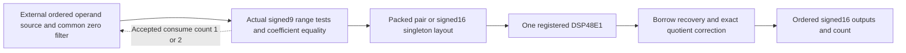

# Exact arithmetic and runtime admission

The primitive computes `L(U,beta) = ceil(beta*U/256)` for signed16 U and integer beta from 0 through 256. Quantizing a floating neuron into this contract is a separate conversion step. Exact packing preserves this integer contract.

The stored membrane always remains signed16. The core inspects two available consecutive operands. It pairs them only when both actual values fit signed9 `[-256,255]` and beta values match. Otherwise it consumes only the first operand and computes it with full signed16 precision. The source must advance by `take` after an accepted request and present the unconsumed operand again. Pairing cannot cross a declared frame boundary. Valid/ready stalls preserve order and hold outputs.

## Packed calculation

For admitted `(u0,u1,beta)`:

```
A = (u0 + 256) + (u1 << 16)
C = 255 - 256*beta + (255 << 16)
P = A*beta + C = x + (y << 16)
x = beta*u0 + 255
y = beta*u1 + 255
```

A fits the DSP48E1 signed25 multiplicand port. `-65536 < x < 65536`, so the lower field can cause at most one negative borrow. Let `n = 1 if x < 0 else 0`. The upper portion equals `T = floor(P/65536) = y-n`. The known parity of y gives an inexpensive reference bit:

```
r = ((beta & 1) & (u1 & 1)) XOR 1
n = bit16(P) XOR r
L0 = unsigned(P[15:8]) - 256*n
L1 = signed9(P[32:24]) + (n AND P[23:16] == 255)
```

The upper quotient needs correction only when adding back the borrow crosses a byte boundary. Both outputs sign extend to signed16. No mantissa, exponent, rescaling, saturation or discarded spill appears in this mechanism.

## Worked negative-borrow example

For `u0=-3`, `u1=5`, `beta=128`, the independent results are `ceil(-384/256)=-1` and `ceil(640/256)=3`. Here `x=-129`, `y=895`, so n=1. The unsigned lower quotient byte is 255. Restoring the borrow gives `255-256=-1`. The upper truncated field is 894, which still gives quotient 3, so its byte correction is zero.

For `u0=-256`, `u1=1`, `beta=1`, x=-1 and y=256. The upper field becomes 255. Adding back its borrow changes quotient 0 into 1. This exercises the rare correction boundary exactly.

For `U=381`, `beta=78`, the result is 117. Signed9 wrapping would turn 381 into -131 and produce -39. The core instead selects a wide singleton and returns 117.

## Architecture and measured boundary



The measured E5 core includes range/equality tests, layout selection, exact correction and the elastic interface. Operand memory, the source queue, variable-consumption source integration and common zero-filter hardware remain external. Unstalled core latency is two advancing edges. A leakage issue is not a full neuron-update cycle.
